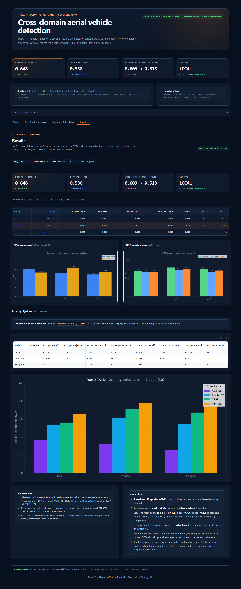
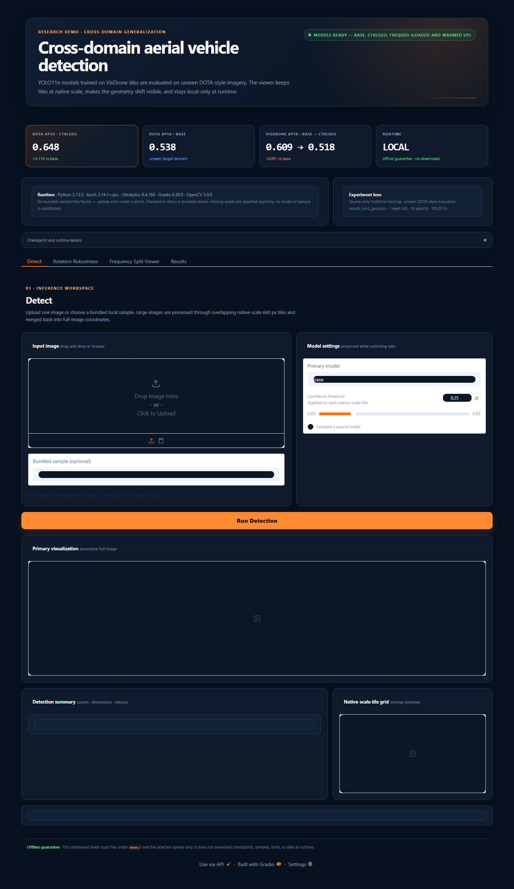

# Cross-domain aerial vehicle detection (VisDrone → DOTA)

A controlled study of **single-source domain generalization** for small-vehicle detection in aerial imagery: train a detector only on drone footage (VisDrone), then test it, with no target images used in training, on near top-down aerial imagery (DOTA). The repository contains the training and evaluation code, the three trained checkpoints, the raw run log, and an offline demo app.



## Summary

- **The domain gap is real but moderate.** A plain YOLO11n trained on VisDrone scores about 0.61 AP50 on its own data and about 0.55 on DOTA. A DOTA-trained reference reaches 0.879 on DOTA (and only 0.015 on VisDrone, so the shift is strongly one-directional).
- **Random 90° rotation augmentation helped the most.** It raised DOTA AP50 by roughly 8–9 points at a cost of about 9 points on VisDrone. Appearance-only changes (colour, brightness, noise) added only 1–2 points.
- **The proposed frequency-split module did not help.** It splits each feature level into low-frequency "structure" and residual "style" parts, aligns structure across pseudo-domains, and decorrelates the two. It scored about 8 AP50 points *below* its own fair control (rotation + style augmentation) on DOTA in all three seeds, and showed the weakest recall on objects under 16 px in the single-seed size breakdown. Why it underperforms is a hypothesis (loss of fine detail), not something the ablations prove.

This is a negative result for the proposed module and a positive result for a simple recipe. The orientation interpretation is a hypothesis supported by the ablation, not a directly tested cause.

## Results

AP50, two classes (small-vehicle, large-vehicle), YOLO11n, 30 epochs, 640 px tiles at native resolution.

**Kaggle run log** (`notebooks/kaggle_run2_log.ipynb`; mean over seeds 0–2 unless noted):

| Model | What it adds | VisDrone | DOTA (unseen) |
|---|---|---|---|
| `base` (1 seed) | Plain YOLO11n | 0.614 | 0.556 |
| `control` (1 seed) | Style-perturbation augmentation | 0.610 | 0.575 |
| `geo` | Random 90° rotations | 0.525 | 0.638 |
| `ctrlgeo` | Style perturbation + rotations | 0.514 | **0.650** |
| `freqgeo` | `ctrlgeo` + frequency split + alignment + decorrelation | 0.490 | 0.566 |
| DOTA-trained (1 seed) | Reference ceiling | 0.015 | 0.879 |

**Bundled checkpoints** (`demo/results_run2_geo.json`, seed 0 only; this is what the demo app displays):

| Model | VisDrone | DOTA |
|---|---|---|
| `base` | 0.609 | 0.538 |
| `ctrlgeo` | 0.518 | 0.648 |
| `freqgeo` | 0.494 | 0.558 |

The two tables come from different runs and differ slightly; the ordering of the models is the same. Do not mix numbers from the two sources.

## What was built

**Benchmark.** Both datasets are cut into tiles of at most 640×640 px at *native* resolution (no resizing), so a 35 px vehicle stays 35 px and any accuracy drop comes from viewpoint, orientation and appearance rather than scale. Classes are matched: VisDrone car and van → small-vehicle; truck and bus → large-vehicle; DOTA small-vehicle and large-vehicle are used as is. DOTA's oriented boxes are converted to axis-aligned boxes.

**Frequency-split detector (`freqgeo`).** On each YOLO11n feature level (P3/P4/P5) an `rfft2` is multiplied by a radial low-pass mask to give a structure map `C`; the style map is `S = f − C`. The detection head reads only `C`. During training, a patch-level domain classifier behind a gradient-reversal layer tries to tell original images from style-perturbed copies using `C` (alignment loss), and a decorrelation loss penalizes correlation between `C` and `S`. In the bundled run the cut-off is fixed at 0.20 cycles/pixel and the alignment weight is 1.0. The "domains" are synthetic: half of each batch is replaced by a photometrically perturbed copy.

**Controls.** `base`, `control`, `geo`, `ctrlgeo` and `freqgeo` add one ingredient at a time, so the proposed module is compared against a control with the same augmentation.

**Evaluation.** AP50 and AP50-95, precision/recall/F1, false positives per tile, and recall by object-size bucket (<16, 16–32, 32–64, >64 px).

## Repository layout

```
demo/       Offline Gradio app, three checkpoints, bundled results, launchers, self-test
training/   Tiling, training, evaluation and Kaggle driver scripts (freq_dg.py is the method)
notebooks/  Executed Kaggle notebook with the full run log
docs/       Screenshots
```

`demo/freq_dg.py` and `training/freq_dg.py` are identical copies. The demo needs it importable because the `ctrlgeo` and `freqgeo` checkpoints reference its classes.

## Run the demo (Windows, Python 3.13)

The demo was tested on Windows with Python 3.13 and CPU PyTorch. Install once while online, from the `demo` folder:

```bat
py -3.13 -m venv .venv
.venv\Scripts\python.exe -m pip install -r requirements.txt
.venv\Scripts\python.exe selftest.py
start_demo.bat
```

Wait for **"Models ready — base, ctrlgeo, freqgeo"**, then open http://127.0.0.1:7860 (if the port is busy the launcher tries 7861–7870 and prints the URL). Runtime needs no internet; telemetry, auto-install and model downloads are disabled. macOS/Linux launchers (`start_demo.sh`) are untested.

**No images are bundled.** The demo is upload-only: supply your own aerial tile on the Detect, Rotation Robustness and Frequency Split Viewer tabs. The Results tab shows the recorded numbers from `results_run2_geo.json` and works without an image. `selftest.py` skips real inference when no image is found, so a passing self-test confirms that models load and helpers work, not detection quality.



## Reproduce the training runs

`training/run_kaggle2.py` is written for a Kaggle GPU notebook (T4 or P100) with Internet on. It downloads VisDrone and DOTA v1.0 from Ultralytics' release assets, builds the tile sets with `build_shared.py`, trains each variant for 30 epochs, and evaluates it right after training (partial results survive a stopped session). The logged run took about 5.4 hours on Kaggle.

```
!pip -q install ultralytics
!SMOKE=1 python training/run_kaggle2.py     # ~5 minute smoke test, must end with DONE
!python training/run_kaggle2.py              # full run
```

Single runs: `python training/train_dg.py MODE EPOCHS SEED`, where MODE is one of `base`, `control`, `split`, `freq`, `geo`, `ctrlgeo`, `freqgeo`, then `python training/evaluate_dg.py RUN_NAME OUT_JSON`. Set `DG_ROOT` to your working directory. The `split` mode (split only, no alignment or decorrelation) exists in the code but was not part of the logged run, so the contribution of the low-pass head alone is untested.

## Limitations

- One source–target pair (VisDrone → DOTA) and a small model (YOLO11n, 30 epochs, 640 px). Results may not transfer to other sensors or larger models.
- `base` and `control` have one seed in the log; the other variants have three. There are no confidence intervals. The demo displays seed 0 only.
- The alignment "domains" are synthetic appearance changes, not real sensor differences, and in-plane rotation does not simulate the camera-pitch difference between the datasets.
- DOTA's oriented boxes were flattened to axis-aligned boxes, which inflates vehicle boxes and affects NMS and IoU.
- The proposed module's final settings (fixed cut-off 0.20, alignment weight 1.0) differ from its original learnable-cut-off design, and DOTA validation tiles were used for evaluation with no separate held-out target split.
- Real-image behaviour of the demo is not verified in this repository because no aerial images are bundled.

## Data, licensing and credits

The datasets are **not** included. Obtain VisDrone (AISKYEYE lab, Tianjin University; https://github.com/VisDrone/VisDrone-Dataset) and DOTA v1.0 (Wuhan University and collaborators; https://captain-whu.github.io/DOTA) under their own terms.

**License: not yet chosen.** The code depends on [Ultralytics YOLO](https://github.com/ultralytics/ultralytics), which is licensed AGPL-3.0, and the checkpoints are fine-tuned from YOLO11n weights, so choose a compatible license before reuse or redistribution.

Built with Ultralytics YOLO11, PyTorch and Gradio.
